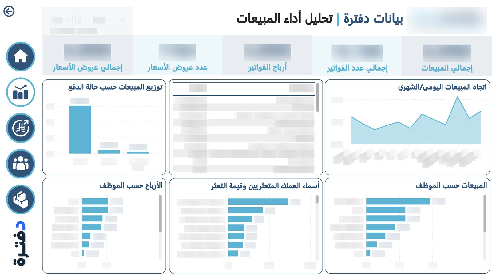
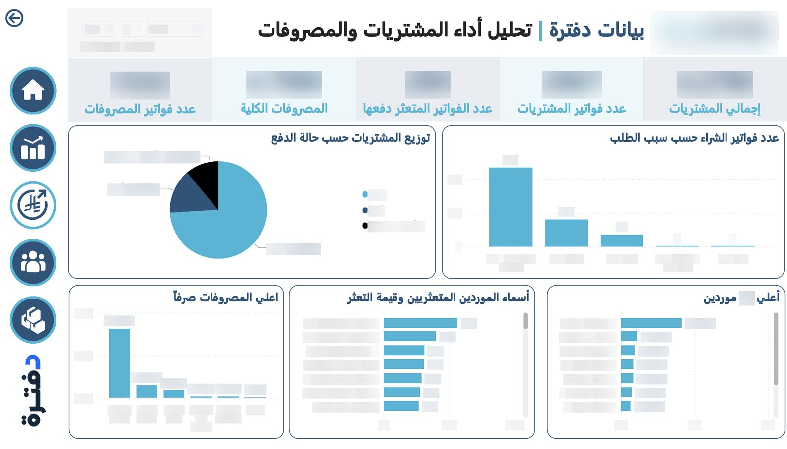
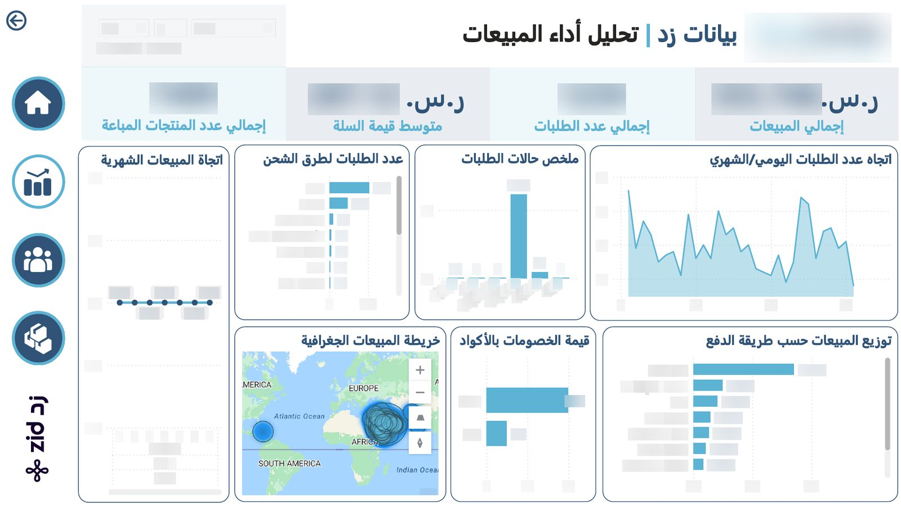
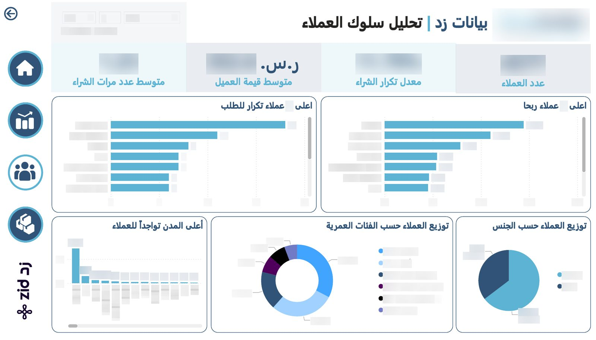

# E-commerce ETL Pipeline & Power BI Dashboard (Zid + Daftra → PostgreSQL → Power BI)


A production ETL pipeline built as a freelance project for an online retail client. It pulls data from two business systems, **Zid** (e-commerce platform) and **Daftra** (accounting/ERP), cleans and models it with Pandas, and loads it into a **PostgreSQL** database that powers a **Power BI** dashboard for sales, purchases, customers, products, and orders.

---

## 📌 Highlights

- **Two API sources, one model:** paginated extraction from the Zid and Daftra REST APIs, merged into a single reporting database.
- **Incremental loading:** each run fetches only records changed since the last load (based on `updated_at` / `modified` timestamps), instead of re-downloading everything.
- **Upserts, not duplicates:** batched `INSERT ... ON CONFLICT` upserts on primary keys keep tables consistent across runs.
- **Rich transformations:** nested JSON from the APIs is flattened into fact and dimension tables (orders, products, customers, categories, locations, shipping methods, abandoned carts, coupons, reviews, invoices, payments, refunds, purchase orders, expenses, ...).
- **Column blacklists** drop unused or sensitive API fields before loading.
- **Scheduling & logging:** a scheduler runs the incremental sync every 12 hours, with shared structured logging for every step.

## 🏗️ Architecture

```
 Zid API ─────┐                                     ┌─► Power BI Data Model (DAX KPIs)
              ├─► Extract ─► Transform ─► Load ─► PostgreSQL ─┤
 Daftra API ──┘   (paginated,  (Pandas)   (batched           └─► Scheduled Refresh
                  incremental)            upserts)
```

## 📂 Repository Structure

```
├── main.py                        # Runs the full pipeline (Zid + Daftra)
├── pipelines/
│   ├── zid/                       # extract.py · transform.py · load.py · main.py
│   └── daftara/                   # extract.py · transform.py · load.py · column_blacklist.py
├── scheduler/
│   └── incremental_scheduler.py   # Incremental sync every 12 hours
├── shared/
│   ├── db_utils.py                # PostgreSQL connection
│   └── logger.py                  # Shared logger
└── Dashboard/                     # Power BI dashboard screenshots
```

## ⚙️ Setup

1. Install dependencies:
   ```bash
   pip install -r requirements.txt
   ```
2. Create a `.env` file with your credentials:
   ```
   DB_USER=...
   DB_PASSWORD=...
   DB_HOST=...
   DB_PORT=5432
   DB_NAME=...
   ZID_AUTHORIZATION_TOKEN=...
   ZID_MANAGER_TOKEN=...
   DAFTARA_API_KEY=...
   ```
3. Run:
   ```bash
   python main.py                                  # full load
   INCREMENTAL=1 python main.py                    # incremental load
   python -m scheduler.incremental_scheduler       # run every 12 hours
   ```

## 📊 Dashboard

The Power BI report (8 pages) covers sales and orders performance, purchases and expenses, customers, and products for both data sources, with dynamic time filters and scheduled refresh.

> Client name and all figures are blurred for confidentiality.

**Daftra: Sales Performance**


**Daftra: Purchases & Expenses**


**Zid: Sales Performance**


**Zid: Customer Behavior**


---

## 👥 Team

- [Kareem Adel](https://www.linkedin.com/in/kareem-adel-mostafa/): Daftra pipeline (`pipelines/daftara/`)
- [Mohamed Hossam](https://www.linkedin.com/in/mohamed-hossam-elgammal/): Zid pipeline (`pipelines/zid/`)
